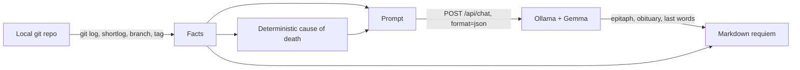

# Repo Requiem

**Every repository deserves a funeral.**

Repo Requiem is a small command-line tool that reads a local git repository's
history and asks an open-weight model, served by [Ollama](https://ollama.com),
to write its obituary: an epitaph, a eulogy, a cause of death, last words, and
what it left behind.

Built for the **Hacktoberfest Open-Source AI Challenge: Week 4 — Ghost in the
Machine**, where the theme is Halloween and Día de los Muertos. The dead in this
case are the repositories we stopped committing to.

```text
     /                                        \
    |                 old-tool                 |
    |            2019-03-02 - 2023-08-11       |
    |                                          |
    |        "It compiled until it could not." |
    |                                          |
     \________________________________________/
```

## What it does

1. Reads the repo's vital signs with `git` — first and last commit, contributors,
   branches, tags, files that were deleted and never came back, the files that
   were touched most, and the README.
2. Makes a dry, deterministic guess at the cause of death (maintainer
   exhaustion, dependency rot, a refactor that never ended...).
3. Sends only those facts to an Ollama model and asks for strict JSON.
4. Renders a Markdown eulogy with an ASCII tombstone and an autopsy table.

No API keys. No database. No web server. One Python file, the standard library,
and `git`.

## Quick start

Requirements: Python 3.9+, git, and [Ollama](https://ollama.com/download).

```bash
# 1. Get a model. A small local one keeps everything on your machine:
ollama pull gemma3:4b

# 2. Clone a repository that has gone quiet, or point at one you already have.
git clone https://github.com/example/abandoned-thing

# 3. Hold the funeral.
python requiem.py abandoned-thing --model gemma3:4b --out obituary.md
```

On Windows, the same commands work in PowerShell.

The default model is `gemma4:cloud`, the tag this project was built and tested
with. Cloud tags are served by Ollama's infrastructure, so the facts leave your
machine. Pass `--model gemma3:4b` (or any locally pulled tag) for a fully local
ritual. The tool never sends your source code — only the history summary and a
short README excerpt.

### Useful flags

```bash
python requiem.py . --dry-run          # print the collected facts, call no model
python requiem.py . --out -            # write the eulogy to stdout
python requiem.py . --commits 1000     # autopsy more history
python requiem.py . --model gemma3:4b  # choose any Ollama tag
```

Set `REQUIEM_MODEL` or `OLLAMA_HOST` if you prefer environment variables.

## Example output

```markdown
# In Memoriam: old-tool

> It compiled until it could not.

## Obituary

For four years, old-tool opened on a Tuesday and closed on a Friday...

## Cause of death

**maintainer exhaustion**

## Last words

> chore: goodnight

## Survived by

a fork and a memory
```

See [`sample-obituary.md`](sample-obituary.md) for a full run.

## How it works



The model is asked for five fields and nothing else. If it returns prose around
the JSON, the parser finds the object. If Ollama is not running, the tool tells
you how to start it instead of failing with a stack trace.

## Tests

```bash
python -m unittest discover -s tests -v
```

The tests build a throwaway git repository, so they need no model and no
network. They cover fact collection, deleted-file detection, the cause-of-death
heuristics, JSON extraction, and rendering.

## Why open?

- **The model is swappable.** One flag moves you from a cloud tag to a 4B model
  on a laptop, or to a model you fine-tuned yourself.
- **The data stays put.** The tool reads a local clone and sends a summary, not
  your code. With a local tag, nothing leaves the machine at all.
- **Nothing expires.** No hosted API key, no vendor dashboard, no service that
  can shut down and take your tool with it.
- **The history is yours.** Git is the archive; the eulogy is just a reading of
  it.

## License

MIT. See [LICENSE](LICENSE).
